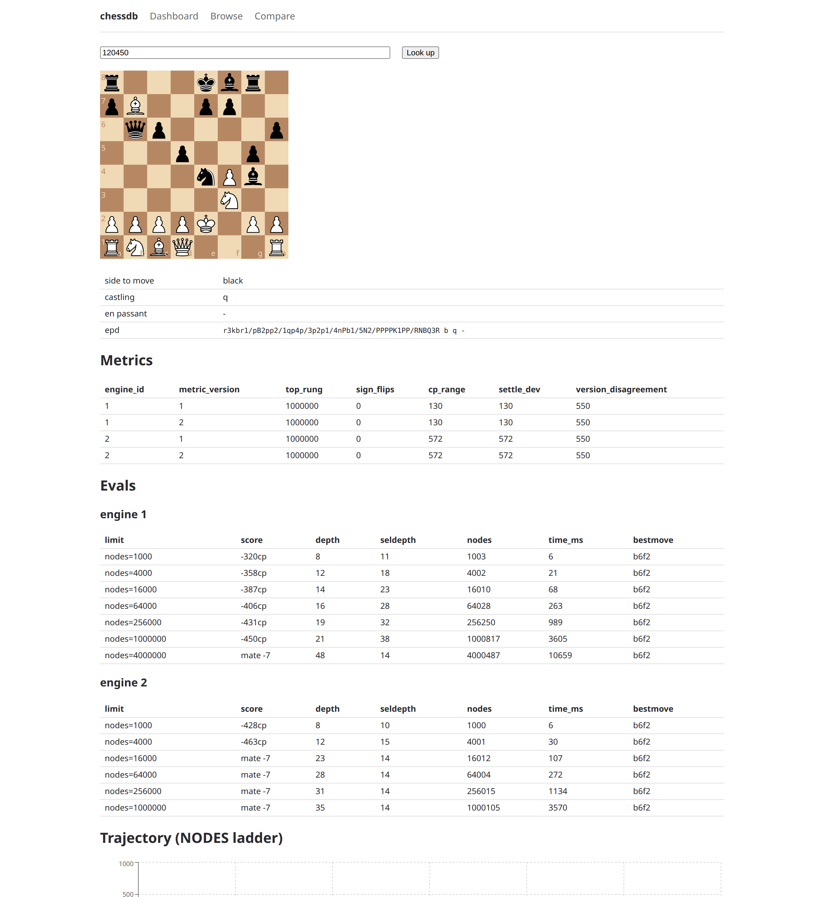

# chessdb


A SQLite database of chess positions where each position carries several
Stockfish evaluations on a ladder of node limits, from 1k to 4M nodes, for more
than one engine version. The point is the eval *trajectory*: a position whose
score swings or flips sign as the search deepens is unstable, and that
instability is the data. Intended uses are chess study and training sets for
evaluation models.



Positions come from seeded semi-random engine games (MultiPV temperature
sampling) or from external EPD files, and are evaluated by a pool of
single-threaded Stockfish workers. Long runs happen on Google Colab with Drive
checkpoints and can be split across parallel sessions. A read-only analysis
site (React, FastAPI, DuckDB) shows distributions, instability metrics and
per-position trajectories, and exports filtered parquet tables.

## Features

- Pinned, sha256-checked Stockfish downloads (`fetch-engine`).
- Node ladder `1k 4k 16k 64k 256k 1M 4M`, one row per (position, engine, rung)
  with depth, seldepth, nodes, time, score and best move.
- Reproducible position generation: replaying a game's seed and sampler config
  yields the same moves and positions.
- Import of external positions with the same screening rule (`import-epd`).
- Resumable runs: killing and rerunning `run` loses or duplicates nothing.
- Parallel sessions with `--shards/--shard-index` and a deterministic `merge`.
- Versioned instability metrics: sign flips, score range, settle deviation,
  cross-engine disagreement and first mate rung. See
  [docs/METRICS.md](docs/METRICS.md).
- Parquet export and a read-only web site over the same filters.

## Layout

- `src/chessdb/`: Python package with `db/` (SQLite schema and typed API),
  `engine/` (UCI harness), `gen/` (position generation), `metrics/`, `cli/`
  and `api/` (FastAPI backend)
- `tests/`: pytest suite
- `web/`: React analysis site (Vite, TypeScript)
- `colab/run.ipynb`: Colab launcher
- `docs/METRICS.md`: metric definitions
- `paper/`: scripts, tables and figures of the article

## Quickstart

```
uv sync
uv run chessdb init --db dev.db
uv run chessdb fetch-engine
uv run chessdb eval --db dev.db --epd "rnbqkbnr/pppppppp/8/8/8/8/PPPPPPPP/RNBQKBNR w KQkq -"
uv run chessdb generate --db dev.db --seed 1 --games 10
uv run chessdb run --db dev.db --seed 1 --games-target 10 --max-hours 1
uv run chessdb metrics --db dev.db
uv sync --extra site
uv run chessdb export --db dev.db --out dev.parquet
uv run chessdb serve --db dev.db
```

- `init` creates or migrates the database and prints a row count per table.
  Safe to rerun.
- `fetch-engine` downloads and verifies the pinned Stockfish release
  (`--version 17.1` or `16.1`) and caches it.
- `eval` runs the node ladder over the given positions.
- `generate` plays seeded games (random opening plies, then MultiPV
  temperature sampling) and keeps positions that pass the screen: no mate and
  |cp| <= 800 at 4k nodes.
- `import-epd --epd-file FILE` screens external positions the same way and
  stores them without a source game.
- `run` interleaves generation and laddered evals until `--games-target` games
  are complete or `--max-hours` runs out. `--top-rung` caps the ladder and
  `--drive-dir` enables checkpoints.
- `merge --db OUT --from A --from B` combines shard checkpoints. The result
  does not depend on the number or order of shards.
- `metrics` computes every metric version in one run. Rerunning on an
  unchanged DB gives identical output.
- `export` writes one row per (position, engine, metric version) to parquet,
  with the same filters as the site.
- `serve` starts the read-only API and validates the DB at startup.

`export` and `serve` need the `site` extra (`pip install 'chessdb[site]'`), so
the base install stays small for Colab.

## API

`chessdb serve --db PATH [--host 127.0.0.1] [--port 8000] [--web-dist DIR]`
serves a read-only JSON API:

- SQLite reads: `/api/meta`, `/api/positions/{id}`,
  `/api/positions/by-epd?epd=`, `/api/positions/{id}/trajectory`
- DuckDB reads: `/api/query`, `/api/distributions`, `/api/depth-by-rung`,
  `/api/export`

`/api/query` and `chessdb export` share the same filter code, so equivalent
calls return the same rows. `--web-dist` serves a built `web/dist` at `/`.

## Web

`web/` has four pages:

- a dashboard with engine tables, metric histograms and depth by rung;
- a position explorer with board, evals and the score trajectory chart;
- a browse page for filtering, sorting and parquet download;
- a compare page with the positions where engine versions disagree most.

Filter state lives in the URL hash, so a filtered view can be shared. Named
filter sets are saved in `localStorage`.

```
cd web
npm install
npm run dev       # http://localhost:5173, proxies /api to :8000
```

Run `chessdb serve --db dev.db` next to it. For a single-process build:

```
cd web && npm run build
uv run chessdb serve --db dev.db --web-dist web/dist
```

The compare page needs two engines. A quick local database with two engines:

```
uv run chessdb init --db two.db
uv run chessdb fetch-engine --version 17.1
uv run chessdb fetch-engine --version 16.1
uv run chessdb run --db two.db --version 17.1 --seed 1 --games-target 4 --top-rung 64000 --max-hours 0.2
uv run chessdb run --db two.db --version 16.1 --seed 1 --games-target 4 --top-rung 64000 --max-hours 0.2
uv run chessdb metrics --db two.db --top-rung 64000
```

The second `run` adds no games. It evaluates the existing positions with the
second engine.

## Tests

```
uv run --extra site pytest
uv run ruff check .
cd web && npm ci && npm run build && npm test && npm run lint
```

Tests that need a real engine or a DuckDB extension download skip themselves
when those are unavailable.

## Colab

`colab/run.ipynb` mounts Drive, clones the repo, installs it, fetches the
engine and calls `chessdb run` with `--drive-dir` on the mounted Drive. The
database is always worked on locally and copied to Drive on a timer and at
exit. To split the work across two sessions, set `SHARDS = 2` and run the
notebook once with `SHARD = 0` and once with `SHARD = 1`, then combine the
checkpoints with `chessdb merge`.

## Article and data

`paper/` holds the scripts, tables and figures of the article *Avaliação
padronizada de posições de xadrez por múltiplas versões de motor e orçamentos
de busca* (MBA in Software Engineering, USP/Esalq). The article text will be
added after its final version. The databases it uses are in the
[`dataset-v1.0` release](https://github.com/abstratovcm/chessdb/releases/tag/dataset-v1.0).
[paper/README.md](paper/README.md) explains how to reproduce the tables and
figures and how the databases were produced.

## License

Code: MIT, see [LICENSE](LICENSE). Data in the `dataset-v1.0` release and in
`paper/dados/`: [CC BY 4.0](https://creativecommons.org/licenses/by/4.0/).
Lichess positions: CC0.
